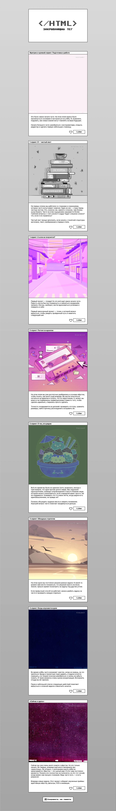

# Закрывающий тег

Страница с восемью карточками об этапах обучения вёрстке. Учебный проект пятого спринта Яндекс Практикума.

[Открыть сайт](https://saakoz14.github.io/zakrivayuschiy-teg/) · [Репозиторий проекта](https://github.com/Saakoz14/zakrivayuschiy-teg)

## Превью сайта

## Возможности

- Адаптивная вёрстка для телефона, планшета и компьютера.
- Восемь карточек с изображениями, CSS-фильтрами и подписями.
- Анимированные SVG-сердца и переключение Like / Unlike.
- Модальное окно сохранения с управлением с клавиатуры.
- Поддержка системной настройки уменьшения анимации.

## Технологии

HTML5, CSS3, JavaScript, Flexbox, Grid Layout, CSS-переменные, медиазапросы и SVG. Локальные шрифты Inter и Press Start 2P.
